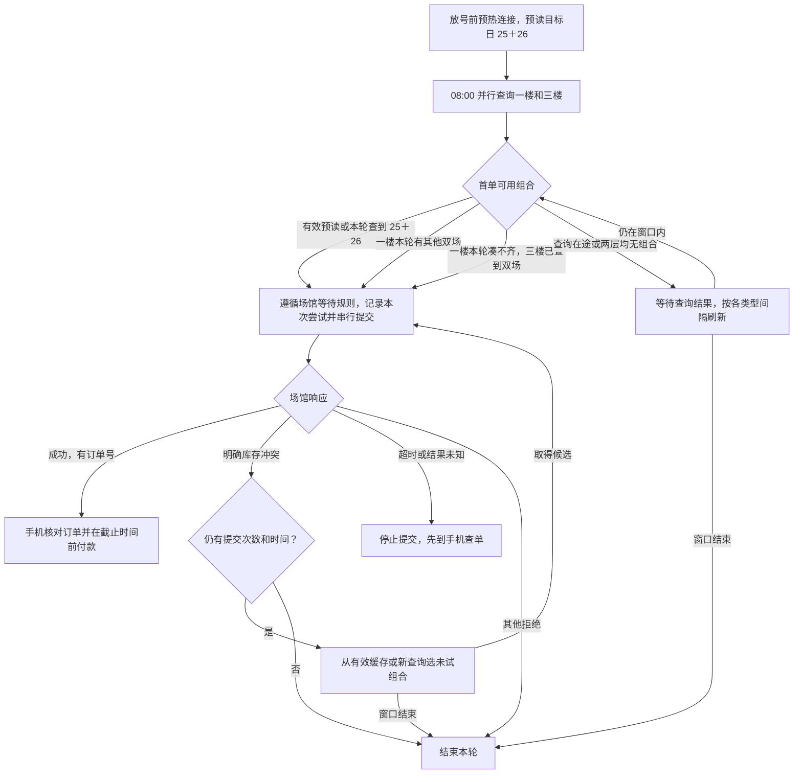

# 宁波奥体中心羽毛球预约

通过本人微信登录会话预约综合馆羽毛球场。默认每周四北京时间 **08:00** 放号时，尝试预约下周三 **19:00–21:00**。每块场地都要连续覆盖整个时段。脚本创建待支付订单后，请在手机微信小程序「我的订单」中核对场地、金额和付款截止时间，完成付款。

## 第一次使用

1. 在 Windows 11 上安装 Python 3.10 或更新版本、电脑微信和 Reqable。脚本仅依赖 Python 标准库。在项目目录打开 PowerShell，运行 `py --version` 确认解释器版本。
2. 打开 [config.json](config.json)，将 `reqable_mcp_path` 改为本机 Reqable 安装目录中的 `mcp-server.exe` 路径。JSON 字符串中的反斜杠要写成 `\\`。
3. 在 Reqable 开启「API 服务」并开始抓包。用自己的电脑微信登录「宁波奥体中心」，依次进入「场馆业务」→「在线营业厅」→「羽毛球」，让 Reqable 留下新的 `webssl.xports.cn` 访问记录。
4. 在项目目录执行以下两条命令。第一条会提示输入 Reqable API 令牌，输入时不回显。脚本从抓包记录读取场馆会话，验证成功后保存到本机。第二条检查这个会话能否读取场馆信息。会员下单权限由场馆在实际提交时校验。

   ```powershell
   py book_badminton.py refresh-session
   py book_badminton.py check
   ```

## 预约下周三的两块场地

先查看计划，核对输出中的放号日期、目标日期、时段和数量。

```powershell
py book_badminton.py plan --court-count 2
```

确认后，在放号前启动定时预约，保持终端运行、电脑开机联网。

```powershell
py book_badminton.py schedule --court-count 2
```

`schedule` 会每周执行。只打算预约一次时，在本轮返回明确结果后按 `Ctrl+C` 退出。按默认配置，在周四 08:00 后 3 分钟内启动会尝试补跑本周，超过该时间就等下周。双击 [启动每周预约.cmd](启动每周预约.cmd) 也会启动定时模式，使用配置中的数量，初始为 **1 块**。希望双击时订两块，可把 `court_count` 改为 `2`。

### 手动预览或立即预约

把下面的日期替换成要订场的实际日期。可以先对同一天运行只读预览，查看候选场地、是否为首选及整单预览价。目标日尚未开放时，预览可能为空。

```powershell
$bookingDate = '2026-11-25'
py book_badminton.py dry-run --date $bookingDate --court-count 2
```

如果该日期已开放，且希望**现在就创建真实订单**，使用单次预约命令。放号前定时等候请使用上面的 `schedule`。

```powershell
py book_badminton.py book --date $bookingDate --court-count 2
```

### 命令速查

以下子命令都跟在 `py book_badminton.py` 后面。`--court-count N` 仅覆盖本次运行的场地数量。`--config PATH` 可指定另一份配置。`--runtime-dir PATH` 可指定会话、日志和订单记录目录。自定义运行目录时，刷新会话、订场和查记录的命令应使用同一目录。

| 子命令 | 作用 |
| --- | --- |
| `plan` | 显示下次放号及目标日期。省略子命令也会显示计划。 |
| `refresh-session` | 从 Reqable 更新本人登录会话。也支持通过 `REQABLE_TOKEN` 环境变量提供令牌。 |
| `check` | 验证本机会话可读取场馆信息。 |
| `dry-run --date YYYY-MM-DD` | 只读预览指定日期的场地组合。 |
| `book --date YYYY-MM-DD` | 立即尝试预约指定日期，执行一轮后退出。 |
| `schedule` | 等待每周放号并尝试预约，结束本轮后继续等下周。 |
| `status` | 查看本机最近的提交记录，最新支付或取消状态以手机订单为准。 |

## 如何选场

| 预约数量 | 首选与备选 |
| --- | --- |
| 1 块 | 首选一楼 10 米区训练 25 号。首选不可用时，按已取得的候选优先选一楼 10 米区，再选三楼。单场首选由 `anchor_court` 指定。 |
| 2 块 | 首选一楼 10 米区训练 **25＋26**。若只剩其中一块，优先用同区另一块补齐。若两块都不可选，也可用该区其他两块。一楼凑不齐时可用三楼两块。 |
| 3 块及以上 | 必须包含训练 25、26 号，其余由一楼 10 米区补齐。可订数量和总时长受当日场馆页面限制。 |

多场预约以同一类型的一笔订单提交。脚本会逐场检查可订状态、连续时段以及场馆的场数、时长和碎片时段规则。训练 25、26 号的物理场地 ID 是 `20009846`、`20009847`。提交还需要目标日各时段的场次 ID，由脚本从目标预约日期的选场页取得。因此即使知道场号，能否在 08:00 直接提交仍取决于预读是否取得有效的完整场次。

### 双场放号流程

按默认配置，调度器在 **07:59:40** 开始验证会话、读取场馆规则并预热连接。准备按时完成时，约 **07:59:58.500** 通过独立连接预读一楼的训练 25＋26。**08:00** 开始并行查一楼和三楼。若已备齐有效首选，主线程可按场馆等待规则直接提交。首选预读在放号后才返回，也可在首单发出前采用。



- **一楼查询仍在进行时**，双场首单会等本轮一楼结果。即使上一轮返回零组、这一轮三楼先查到了组合，也会给正在查询的一楼首选机会。场馆要求的倒计时可能使候选过期，此时会重新查询。
- **后台线程只查库存**。下单统一由主线程串行发送。只有场馆明确返回库存冲突时才会换组合。首单和备选共用最多 3 次提交。若 25＋26 冲突，且 24＋27 可订，脚本会优先使用后者，减少复用可能已被占用的场地。
- **提交前先写本机记录**。相同场馆、日期和时段已有提交记录时，新的运行会停止，以免重复创建订单。

## 常用配置

| 字段 | 默认值 | 作用 |
| --- | --- | --- |
| `court_count` | `1` | 每笔订单的场地块数。 |
| `start_time` / `end_time` | `19:00` / `21:00` | 每块场地都要覆盖的时段，支持整点或半点。 |
| `release_weekday` / `release_time` | `3` / `08:00:00` | 北京时间放号日与时间。周一为 0，周四为 3。 |
| `target_days_after_release` | `6` | 目标预约日在放号日之后的天数。 |
| `field_type_priority` | `["2434", "842"]` | 默认查询一楼 10 米区和三楼。双场模式需要包含一楼 10 米区。 |
| `warmup_seconds` / `catch_up_seconds` | `20` / `180` | 放号前预热提前量与启动过晚时的补跑范围。 |
| `poll_interval_seconds` / `candidate_ttl_seconds` | `1` / `2` | 同类型查询结束到下次查询的最短间隔，以及候选在客户端的有效时间。 |
| `max_wait_seconds` / `max_commit_attempts` | `30` / `3` | 本轮选场窗口（秒）和提交次数上限。已发出的请求会等待响应或超时。 |
| `http_timeout_seconds` | `8` | 单次网络操作的超时（秒）。 |

## 查单与排查

默认运行目录是 `%LOCALAPPDATA%\BadmintonBooking`。`session.json` 包含本人的场馆登录凭证，应保存在本机并排除在 Git 提交之外。`booking.log` 可查看查询、选场和提交的时间线。`orders` 中的 JSON 记录每笔尝试、场号、服务器返回的订单号及付款信息。

| 现象 | 如何处理 |
| --- | --- |
| 找不到 Reqable 或读不到场馆请求 | 核对 `reqable_mcp_path` 和 Reqable API 服务，重新在本人电脑微信访问羽毛球营业厅，再执行 `refresh-session`。 |
| 会话失效或要求登录会员 | 在微信重新登录并进入选场页，抓取新请求后运行 `refresh-session` 和 `check`。页面要求人机验证时，在小程序操作。 |
| 想查为何选了某个楼层 | 在 `booking.log` 中找 `类型=2434`（一楼）、`类型=842`（三楼）、`训练25＋26` 和 `提交开始`，比较返回与提交时间。候选数表示可组成的订单组合数。 |
| 已创建订单、金额与预览不同 | 在微信小程序「我的订单」核对最终金额与付款期限。脚本显示的预览价来自选场页，实际应付金额以服务器订单为准。 |
| 提交超时、状态为 `sending` 或 `unknown`、发现已有记录 | 先运行 `py book_badminton.py status`，再核对手机「我的订单」。保留提交记录直到确认实际结果，避免重复锁场。 |

## 离线测试

在项目根目录运行测试。测试用模拟场馆响应覆盖按时和迟到的预读、一楼与三楼的返回顺序、库存冲突换场、网络超时及重复下单保护，无需登录。

```powershell
py -B -m unittest discover -v
```
